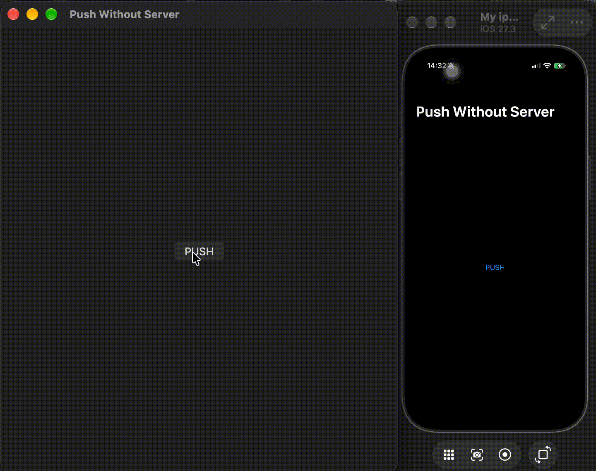

#  Swift: Push Notification without a Server


A demo of sending push notification without a server from one device to another
where both are running the same app using the same account.

For more details, please refer to my blog []()




## Basic Idea
1. Subscribe to one of the `CKSubscription`.
2. Modify some data on what you subscribed to. If that is a specific record type, insert / update / delete it; if it is a zone, make some modifications to data in that zone; if it is a database, make some modifications to data in that database.

## SwiftData Model vs CKRecord

This example uses SwiftData `Model` to trigger the push notification as well as setting the contents of it. 
You can, and it is better to, use a `CKRecord` directly if your app is not currently backed with SwiftData and the notification is not triggered due to a SwiftData change.

```swift
let record: CKRecord = .init(recordType: "ItemModel")

record.setValuesForKeys([
    "timestamp: Date()
])

let _ = try await self.privateDatabase.save(record)
```

If using the record above, 
- the `recordType` passing into `CKQuerySubscription` will simply be `ItemModel` (instead of `CD_ItemModel` for SwiftData model), and 
- the `FieldKey` for `notificationInfo.desiredKeys` will be `timestamp`


## Send To Other Users

### Specific set of users

We can extend the idea to send push notifications to a set of selected users by using the shared database and `CKShare`, where

1. We share a specific `CKRecord` to other users (the other users will have to accept the share)
2. we subscribe to the change on this specific record
3. when we want to push a notification to the group (either from the owner or one of the shared user), we modify this specific record

The base is the same as how we have made a [content collaboration app with CloudKit](https://levelup.gitconnected.com/swiftui-a-simple-simultaneous-content-collaboration-app-with-icloud-b50802aa4007). 


### All users

Similarly, if one user want to push a notification to ALL users of this app, we can use the [public database](https://developer.apple.com/documentation/cloudkit/ckcontainer/publicclouddatabase) by simply add or modify an record in it.


